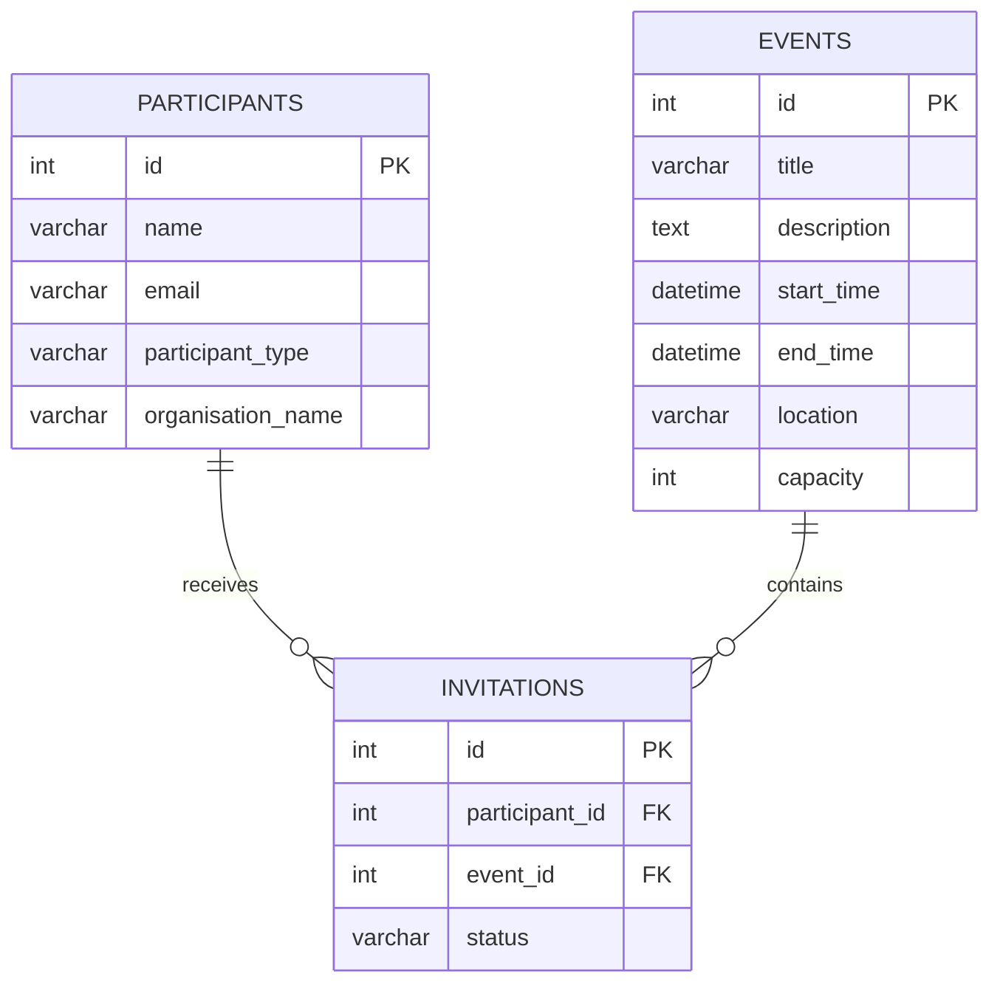

# Database Design

## The Society of Impossible Occasions

## 1. Database Information

- Database name: `society_events`
- Database management system: MySQL
- Java connectivity: JDBC

## 2. Participants Table

Stores individual participants and organisation representatives.

| Column | Data Type | Constraint |
|---|---|---|
| id | INT | Primary key, auto increment |
| name | VARCHAR(100) | NOT NULL |
| email | VARCHAR(255) | NOT NULL |
| participant_type | VARCHAR(20) | NOT NULL |
| organisation_name | VARCHAR(150) | Nullable |

Participant types:

- INDIVIDUAL
- ORGANISATION

## 3. Events Table

Stores information about events organised by the society.

| Column | Data Type | Constraint |
|---|---|---|
| id | INT | Primary key, auto increment |
| title | VARCHAR(150) | NOT NULL |
| description | TEXT | Optional |
| start_time | DATETIME | NOT NULL |
| end_time | DATETIME | NOT NULL |
| location | VARCHAR(200) | NOT NULL |
| capacity | INT | NOT NULL, greater than zero |

## 4. Invitations Table

Connects participants to events and records invitation responses.

| Column | Data Type | Constraint |
|---|---|---|
| id | INT | Primary key, auto increment |
| participant_id | INT | Foreign key, NOT NULL |
| event_id | INT | Foreign key, NOT NULL |
| status | VARCHAR(20) | NOT NULL, default PENDING |

Invitation statuses:

- PENDING
- ACCEPTED
- DECLINED

## 5. Entity Relationship Diagram

## 6. Database Relationships

- One participant can receive multiple invitations.
- One event can have multiple invitations.
- Each invitation belongs to one participant and one event.
- Participants and events have a many-to-many relationship through invitations.

## 7. Business Rules

- An event must have a positive capacity.
- An event must end after its start time.
- A participant cannot receive duplicate invitations to the same event.
- Only accepted invitations count towards event capacity.
- An invitation cannot be accepted if the event is full.
- Organisation representatives must have an organisation name.
- Available places equal event capacity minus accepted invitations.

## 8. Data Integrity

- Primary keys uniquely identify records.
- Foreign keys maintain valid relationships.
- A combined UNIQUE constraint on participant_id and event_id prevents duplicate invitations.
- CHECK constraints enforce valid values where appropriate.
- JDBC prepared statements protect against SQL injection.
- Transactions maintain consistency when accepting invitations.

## 9. Database Security

- Database credentials are stored separately in db.properties.
- The credentials file is excluded from Git using .gitignore.
- Credential file protection has been verified.
- A db.properties.example file provides a safe configuration template.
- Try-with-resources automatically closes database connections and resources.
- A dedicated database user with limited privileges is planned.

## 10. Implementation Status

- [x] Design database structure.
- [x] Identify table relationships.
- [x] Define business rules.
- [x] Create SQL setup script.
- [x] Create MySQL database.
- [x] Create tables and constraints.
- [x] Insert sample data.
- [x] Test SQL queries.
- [x] Configure MySQL JDBC driver.
- [x] Establish JDBC connection.
- [x] Protect database credentials from Git.
- [x] Create example configuration file.
- [x] Test data retrieval through Java.
- [x] Implement and test Participant DAO.
- [x] Implement and test Event DAO.
- [ ] Implement and test Invitation DAO.
- [ ] Implement transaction management.
- [ ] Configure a dedicated database user.